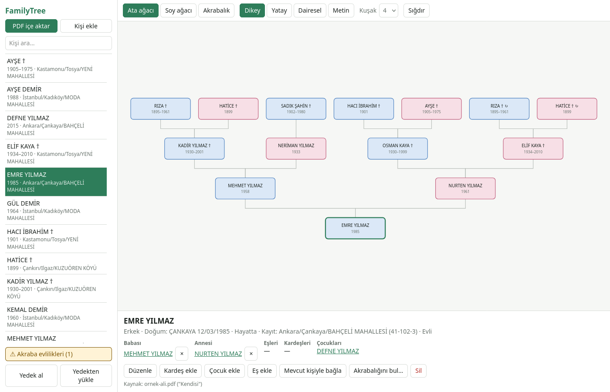

# FamilyTree

e-Devlet'ten alınan **Alt-Üst Soy Bilgisi** PDF'lerini **tamamen yerel** bir veritabanında
birleştiren, eksik akrabaları elle eklemeye izin veren, iki kişi arasındaki akrabalığı ve aile
içindeki akraba evliliklerini bulan, sonucu ağaç diyagramı olarak gösteren masaüstü uygulaması
(Linux ve Windows).



## Özellikler

- **PDF içe aktarma:** e-Devlet soy ağacı çıktısı okunur; "Babasının Annesinin Babası" gibi
  yakınlık ifadelerinden kimin kimin anne-babası olduğu çıkarılır. İfadeler PDF sahibine
  göredir, veritabanında yalnızca gerçek bağlar tutulur.
- **Birden çok PDF:** kuzenlerin ve diğer akrabaların PDF'leri eklenebilir. Ortak kişiler ad,
  anne-baba adı, doğum bilgisi ve nüfus kaydına göre eşleştirilir; önizlemede önerilir, siz
  onaylamadan birleştirilmez. Aynı PDF'te iki kez geçen ata (akraba evliliği) tek kişi olur.
- **Elle ekleme:** PDF'te çıkmayan kardeş, amca, dayı, hala, teyze… "Kardeş ekle" ile (amca =
  babanın kardeşi), anne-baba, çocuk ve eş eklenebilir; var olan kişiler birbirine bağlanabilir.
  Elle düzeltilen bilgiyi sonraki içe aktarmalar ezmez.
- **Akrabalık bulma:** iki kişinin en yakın ortak ataları ve Türkçe akrabalık adı
  ("Teyzesi", "2. dereceden kuzeni (1 kuşak fark)", "Baba bir kız kardeşi"…).
- **Akraba evliliği raporu:** ortak atası olan çiftler otomatik listelenir.
- **Ortak atalar ağaçta:** akraba evliliğindeki ortak ata her iki kolda da yerinde, aynı renkte
  "ikiz kart" olarak görünür; üzerine gelince iki kart arasında bağlantı belirir, tıklayınca
  asıl karta gidilir. İstenirse ayarlardan tek kart + renkli birleşme oku seçilebilir.
- **Dört görünüm:** dikey kutulu ağaç, yatay ağaç, dairesel (yelpaze) ağaç ve girintili metin;
  ata ağacı, soy ağacı ve iki kişi arasındaki akrabalık yolu için.
- **Birden çok soy ağacı:** "Benim ağacım", "Eşimin ağacı" gibi birbirinden bağımsız ağaçlar
  açılabilir; içe aktarma, eşleştirme ve akrabalık hesabı yalnızca açık ağaçta çalışır.
- **Yedekleme:** açık ağaç tek bir JSON dosyasına alınıp geri yüklenebilir.

## Gizlilik

Uygulamanın ağ erişimi yoktur; hiçbir bilgi bilgisayardan çıkmaz. Her soy ağacı kullanıcı veri
klasöründe ayrı bir dosyadır (Linux: `~/.local/share/FamilyTree/agaclar/<ad>.db`, Windows:
`%APPDATA%\FamilyTree\agaclar\<ad>.db`).

Bu depodaki örnek PDF'ler (`tests/fixtures/`) ve ekran görüntüsü **tamamen uydurma** kişilerle
üretilmiştir (`core/examples/make_fixture.rs`). Gerçek PDF'ler, veritabanları ve yedekler
`.gitignore` ile depo dışında tutulur.

## e-Devlet'ten PDF alma

1. e-Devlet'te **Alt-Üst Soy Bilgisi Sorgulama** hizmetini açın.
2. Sonucu tarayıcının **Yazdır** menüsünden **PDF olarak kaydet**in.
3. FamilyTree'de **PDF içe aktar**a basıp dosyayı seçin.

PDF okunamazsa uygulama kişisel bilgi içermeyen bir **düzen dökümü**
sunar (her kelime `x`, her sayı `0`; uzunluklar da gizlenir); bunu bir hata kaydına ekleyerek ayrıştırıcının düzeltilmesine yardım edebilirsiniz.
Aynı döküm komut satırından da alınabilir:

```
cargo run -p familytree-core --example layout_dump -- ~/soyagaci.pdf
```

## Derleme

Gerekenler: Rust (stable), Linux'ta `build-essential pkg-config libwebkit2gtk-4.1-dev
libgtk-3-dev librsvg2-dev libxdo-dev libssl-dev`; kurulum paketi için Node.js.

```
cargo test --workspace            # testler
cargo run -p familytree           # uygulama
npm install && npx tauri build    # .deb / .AppImage / Windows kurulumu
```

## Lisans

MIT
