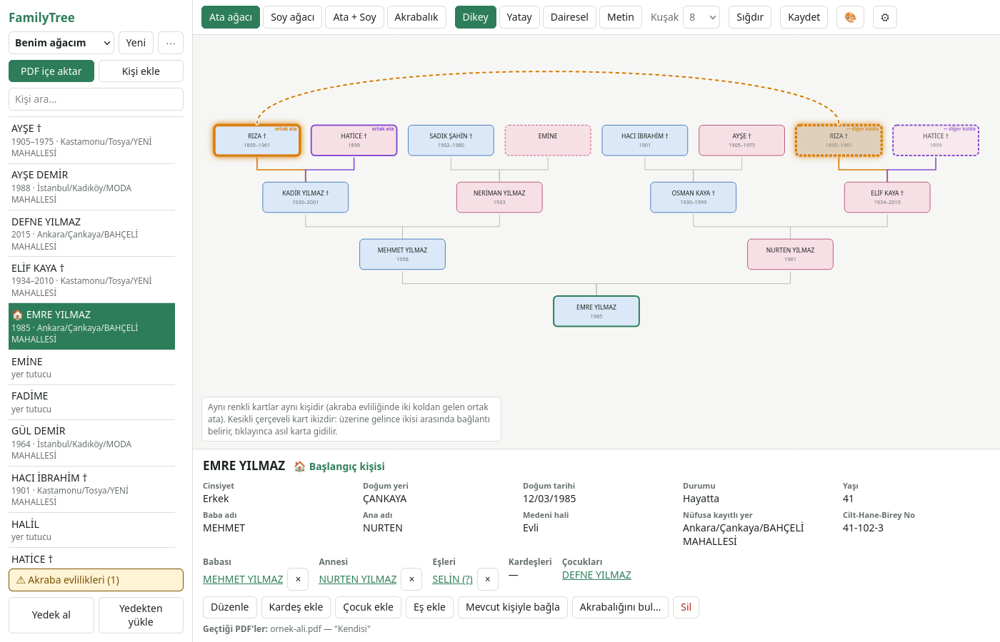
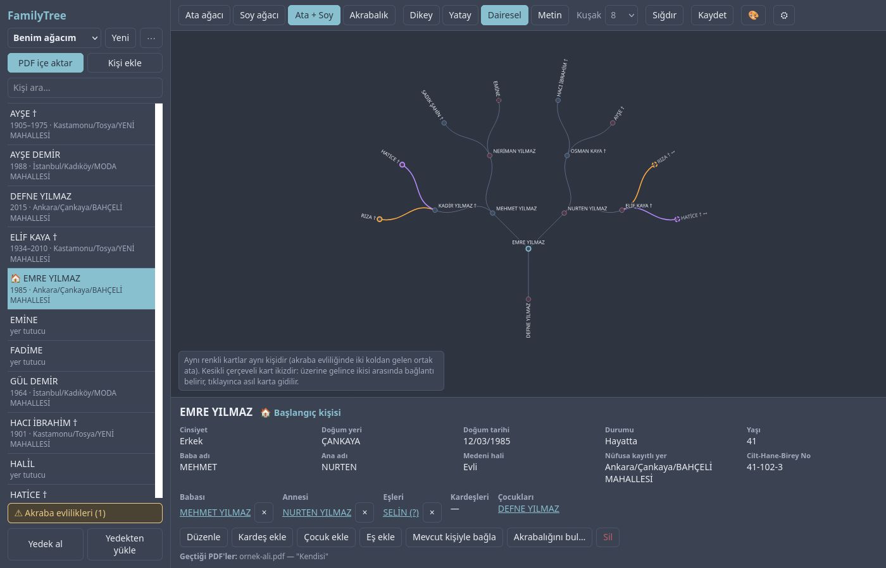

# FamilyTree

e-Devlet'ten alınan **Alt-Üst Soy Bilgisi** PDF'lerini tamamen yerel bir veritabanında
birleştiren, eksik akrabaları elle eklemeye izin veren, iki kişi arasındaki akrabalığı ve aile
içindeki **akraba evliliklerini** bulan, sonucu modern ağaç diyagramlarıyla gösteren masaüstü
uygulaması. **Windows**, **macOS** ve **Ubuntu (Linux)** için.

Verileriniz bilgisayarınızdan çıkmaz: uygulamanın ağ erişimi yoktur.

<p align="center">
  
</p>

> Ekran görüntülerindeki tüm kişiler uydurmadır.

## Özellikler

### 📥 e-Devlet PDF'inden otomatik ağaç
- Alt-Üst Soy Bilgisi çıktısındaki tablo okunur; **"Babasının Annesinin Babası"** gibi yakınlık
  ifadelerinden kimin kimin anne-babası olduğu çıkarılır. Çok sayfalı tablolar, satıra
  kaydırılmış hücreler, ortalanmış sütunlar ve yazdırma üst/alt bilgileri desteklenir.
- PDF'te kendi satırı olmayan en üst kuşak, kişilerin **baba/ana adlarından** yer tutucu olarak
  tamamlanır; kardeşler aynı ebeveynleri paylaşır. Gerçek satır sonradan başka bir PDF'le gelirse
  yer tutucuyla birleşir.
- Aynı ata akraba evliliği nedeniyle PDF'te iki kez geçse bile **tek kişi** olarak kaydedilir.
- Sıra numaraları denetlenir: bir satır ya da sayfa okunamazsa eksik ağaçla sessizce devam
  edilmez.

### 👪 Birden çok PDF, birden çok ağaç
- Kuzenlerin, kardeşlerin ve diğer akrabaların PDF'leri aynı ağaca eklenebilir; ortak kişiler ad,
  anne-baba adı, doğum bilgisi ve nüfus kaydına göre eşleştirilir. Eşleşmeler **önizlemede
  önerilir, siz onaylamadan birleştirilmez**.
- "Benim ağacım", "Eşimin ağacı" gibi **birbirinden bağımsız ağaçlar**; her biri ayrı dosyadır
  ve kendi **başlangıç kişisi**ne sahiptir (program ve ağaç her açıldığında ondan başlar).

### ✍️ Elle düzenleme
- PDF'te çıkmayan kardeş, amca, dayı, hala, teyze… tek tıkla eklenir (amca = babanın kardeşi).
- Anne-baba, çocuk, eş ekleme; var olan iki kişiyi birbirine bağlama; kişi birleştirme.
- Elle düzeltilen bilgiler (✎) sonraki içe aktarmalarda ezilmez ve eşleştirmeyi bozmaz.

### 🧬 Akrabalık
- İki kişinin en yakın ortak ataları ve Türkçe akrabalık adı: *Teyzesi*, *Amcası*,
  *2. dereceden kuzeni (1 kuşak fark)*, *Baba bir kız kardeşi*…
- **Akraba evliliği raporu:** ortak atası olan çiftler otomatik listelenir.

### 🌳 Görünümler
- **Ata + Soy** (kum saati), **Ata ağacı**, **Soy ağacı** ve **Akrabalık yolu**.
- **Yatay**, **Dikey**, **Dairesel** (yelpaze) ve **Metin** çizimleri; 2–15 kuşak.
- Akraba evliliğindeki ortak atalar **renk kodlu ikiz kartlar** olarak her kolda yerinde
  görünür; üzerine gelince ikizler arasında bağlantı belirir, tıklayınca asıl karta gidilir.
  İstenirse tek kart + renkli birleşme oku gösterimi seçilebilir.
- Kişiye tıklayınca tüm bilgileri (doğum, ölüm, yaş, nüfus kaydı, geçtiği PDF'ler) alt panelde.
- Yakınlaştırma (fare tekerleği), sürükleyerek kaydırma, **Sığdır**.

<p align="center">
  
  
</p>

### 💾 Dışa aktarma ve yedek
- Görünümü **PNG**, **PDF** (sayfa ağacın boyutunda) ya da **SVG** (vektörel) olarak kaydetme;
  istenirse açık temayla, yazdırmaya uygun. Metin görünümü `.txt` olarak.
- Açık ağacın tamamını tek bir **JSON yedeği** olarak alıp geri yükleme.

### 🎨 Görünüm ayarları
- 8 tema: Sistem, Orman Açık/Koyu, Classic Light, GitHub Light, Sepia, Obsidian Dark, Nord Frost.
- Vurgu rengi, vefat işareti (**†** / **(ö.)** / gösterme), ortak ata gösterimi; seçimler hatırlanır.

## Kurulum

En son sürüm: [**Releases**](https://github.com/cafercan/FamilyTree/releases/latest).
Her sürümde dosyaların özeti `SHA256SUMS.txt` ile yayımlanır.

### Windows

1. **`FamilyTree-<sürüm>-windows-x64-setup.exe`** kurulumunu indirip çalıştırın.
   Kullanıcı başına kurulur, yönetici izni istemez.
2. Uygulama imzasız olduğu için Windows SmartScreen uyarı verebilir:
   **Ek bilgi → Yine de çalıştır**.
3. Kurulum **Başlat** menüsüne ve **Uygulamalar** listesine eklenir; oradan temiz kaldırılır
   (soy ağaçlarınız silinmez).

Gereksinim: Windows 10/11 x64 ve Microsoft Edge **WebView2** (Windows 11'de yerleşik; yoksa
kurulum uyarır: <https://developer.microsoft.com/microsoft-edge/webview2/>).

### macOS

1. **`FamilyTree-<sürüm>-macos-arm64.dmg`** dosyasını açın ve **FamilyTree**'yi
   **Applications** klasörüne sürükleyin.
2. Uygulama Apple tarafından imzalanmadığı için ilk açılışta macOS engelleyebilir:
   **Applications**'ta uygulamaya **sağ tıklayın → Aç → Aç**. Ya da Terminal'de:

   ```bash
   xattr -dr com.apple.quarantine /Applications/FamilyTree.app
   ```

Gereksinim: Apple Silicon (M1 ve sonrası), macOS 11 veya üstü.

### Ubuntu / Debian

```bash
sudo apt install ./familytree_<sürüm>_amd64.deb
```

Uygulama menüsünde **FamilyTree** olarak görünür. Kaldırmak için: `sudo apt remove familytree`

Gereksinim: Ubuntu 22.04 veya üstü (x86-64). WebKitGTK paket yöneticisi tarafından kurulur.

## e-Devlet'ten PDF alma

1. e-Devlet'e girip [Alt-Üst Soy Bilgisi Sorgulama](https://www.turkiye.gov.tr/nvi-alt-ust-soy-bilgisi-sorgulama)
   hizmetini açın ve sorgulayın.
2. Sonuç sayfasındaki **Yazdır** düğmesine basın.
3. Açılan yazdırma penceresinde:
   - Hedef / yazıcı: **PDF olarak kaydet**
   - **"Üst bilgi ve alt bilgileri yazdır"** kutucuğunun işaretini **kaldırın**; tarih, adres ve
     sayfa numarası tabloya karışmasın.
   - Kağıt: **A4**, yön: **Yatay** önerilir. Uygulama sayfa boyutundan etkilenmez; önemli olan
     tablonun tüm sütunlarının sayfaya sığması (gerekirse ölçek: **Sayfaya sığdır**).
4. PDF'i kaydedin ve FamilyTree'de **PDF içe aktar** ile seçin.

Kuzenlerinizin, eşinizin ya da diğer akrabalarınızın PDF'lerini de aynı yolla alabilirsiniz (her
kişi kendi e-Devlet hesabından). Ayrı tutmak istediğiniz aileler için sol üstteki **Yeni** ile
ayrı bir ağaç açın.

## Kullanım ipuçları

| İşlem | Nasıl |
|---|---|
| Kişinin bilgilerini görmek | Ağaçta kişiye **tıklayın** |
| Ağacı bir kişiden başlatmak | Kişiye **çift tıklayın** ya da listeden seçin |
| Başlangıç kişisini ayarlamak | Kişiye **sağ tıklayın → 🏠 Başlangıç kişisi olarak ata** |
| Amca / dayı / hala / teyze eklemek | Babayı ya da anneyi seçin → **Kardeş ekle** |
| İki kişinin akrabalığı | Kişiye sağ tıklayın → **Akrabalığını bul…** ya da **Akrabalık** sekmesi |
| Akraba evlilikleri | Sol alttaki **⚠ Akraba evlilikleri** |
| Ağaç işlemleri | Ağaç seçicinin yanındaki **⋯**: yeniden adlandır, sil, en üst kuşağı tamamla |
| Kaydetme | Araç çubuğunda **Kaydet** (PNG / PDF / SVG) |
| Tema | Araç çubuğunda **🎨**; diğer ayarlar **⚙** |

## Gizlilik

- Uygulamanın **ağ erişimi yoktur** (içerik güvenlik politikası yalnız yerel arayüze izin verir;
  ağ eklentisi yoktur); hiçbir bilgi bilgisayardan çıkmaz.
- Her soy ağacı kullanıcı veri klasöründe ayrı bir SQLite dosyasıdır:
  - Windows: `%APPDATA%\FamilyTree\agaclar\<ad>.db`
  - macOS: `~/Library/Application Support/FamilyTree/agaclar/<ad>.db`
  - Linux: `~/.local/share/FamilyTree/agaclar/<ad>.db`
- Uygulamayı kaldırmak soy ağaçlarınızı silmez; isterseniz bu klasörü elle silebilirsiniz.
- Bu depodaki örnek PDF'ler (`tests/fixtures/`) ve ekran görüntüleri **tamamen uydurma**
  kişilerle üretilmiştir (`core/examples/make_fixture.rs`). Gerçek PDF'ler, veritabanları ve
  yedekler `.gitignore` ile depo dışında tutulur.

## Sorun giderme

**PDF okunamadı.** Farklı bir e-Devlet çıktı düzeni olabilir. Uygulama, kişisel bilgi
içermeyen bir **düzen dökümü** sunar: her kelime yalnızca `x`, her sayı `0` olarak görünür
(uzunluklar bile gizlenir), yalnızca sütun başlıkları okunur kalır. Bu dökümü bir hata kaydına
ekleyerek ayrıştırıcının düzeltilmesine yardımcı olabilirsiniz. Komut satırından da alınabilir:

```bash
cargo run -p familytree-core --example layout_dump -- ~/soyagaci.pdf
```

**Bir kişi iki kez görünüyor.** Sol kenardaki **Olası aynı kişiler** bölümünden
**Birleştir** ya da **Farklı kişiler** deyin.

## Geliştirme

Yapı: Rust (Cargo workspace) + [Tauri 2](https://tauri.app).

```
core/        İş mantığı ve testler: PDF okuma, tablo ayrıştırma, aile grafiği, SQLite,
             eşleştirme, akrabalık, ağaç yerleşimi, yedek, PDF dışa aktarma
src-tauri/   Masaüstü kabuğu ve IPC komutları
ui/          Arayüz (paketleyicisiz HTML/CSS/JS; çizimler SVG)
tests/       Uydurma örnek PDF'ler ve beklenen çıktılar
installer/   Windows kurulumu (Inno Setup)
packaging/   .deb (Linux) ve .dmg (macOS) paketleme betikleri
```

Gerekenler: Rust (stable), Node.js (paketleme için). Linux'ta ayrıca:

```bash
sudo apt install build-essential pkg-config libwebkit2gtk-4.1-dev libgtk-3-dev \
  librsvg2-dev libxdo-dev libssl-dev
```

```bash
cargo test --workspace                 # testler
cargo run -p familytree                # uygulama
cargo run -p familytree -- --selftest  # pencere açmadan deneme
npm install                            # Tauri CLI (paketleme için)
bash packaging/linux/build-deb.sh      # dist/familytree_<sürüm>_amd64.deb
bash packaging/macos/build-dmg.sh      # dist/FamilyTree-<sürüm>-macos-arm64.dmg (macOS'ta)
.\scripts\build-installer.ps1          # dist\FamilyTree-<sürüm>-windows-x64-setup.exe (Windows'ta)
```

Örnek PDF'leri yeniden üretmek için:

```bash
cargo run -p familytree-core --example make_fixture -- \
  /usr/share/fonts/truetype/dejavu/DejaVuSans.ttf tests/fixtures
```

### Sürüm yayınlama

1. `src-tauri/tauri.conf.json` (ve iki `Cargo.toml`) içindeki sürümü artırın.
2. GitHub'da `v<sürüm>` etiketiyle bir **Release** yayınlayın.
3. İş akışı etiketin uygulama sürümüyle aynı olduğunu denetler; Windows (Inno Setup), macOS (DMG)
   ve Ubuntu (.deb) paketlerini derleyip pencere açmadan dener, release'e `SHA256SUMS.txt` ile
   birlikte yükler. Dosya adları ve kimlikler (Windows AppId, `.deb` paket adı, macOS paket
   kimliği) sürümler arasında değişmez; uygulama [C Launcher](https://github.com/cafercan/c-launcher)
   ile kurulup güncellenebilecek biçimdedir.

## Lisans

[MIT](LICENSE)
